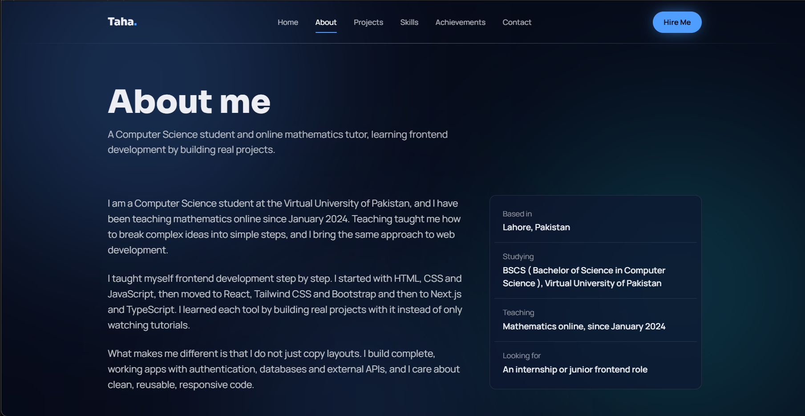

# Syed Taha Bukhari | Portfolio

**Turning ideas into fast, clean, responsive web experiences.**

[Live Demo](https://your-portfolio.vercel.app) .

<!-- Replace with a real screenshot or a short GIF of the Home page -->

---

## About This Project

This is my personal portfolio website, built to present my frontend projects, skills, certificates and achievements to recruiters and hiring managers. I am a BSc Computer Science student and online mathematics tutor looking for my first internship or junior frontend developer role, so the site focuses on real projects instead of work history.

Everything on the site can be managed from a built-in, password-protected Admin Panel, so I can add new projects, experience and certificates without touching the code.

---

## Features

- **6 pages:** Home, About, Projects, Skills, Achievements and Contact, all linked through a sticky navigation bar
- **Cinematic dark design** with a soft, slowly drifting glowing gradient background
- **Smooth animations:** scroll-reveal sections, animated stat counters, hover effects and sliding cards
- **Projects page** with filter tabs (All, React Apps, Next.js Apps, HTML/CSS/JS Websites) and a lightbox for each project
- **Experience timeline, skill meters and certification cards** that update from the database
- **Contact form** with validation, a success message, and direct email, phone and WhatsApp links
- **Admin Panel** (`/admin`) to edit page text, projects, skills, experience, achievements, contact details, images and messages
- **4 color themes** (Charcoal Orange, Midnight Blue, Slate Purple, Emerald Dark) switchable live from the Admin Panel
- **Fully responsive** on phones, tablets and desktops

---

## Projects Showcased

| Project | Built With | Links |
| --- | --- | --- |
| **Hirrd**, a full job portal | React, Tailwind CSS, shadcn/ui, Supabase, Clerk | 
| **Travel App** | Next.js 16, TypeScript, Tailwind CSS v4, deployed on Vercel | 
| **Car Showroom App** | Next.js, TypeScript, Tailwind CSS v4, HeadlessUI, RapidAPI |
| **Sidcup Family Golf Website** | HTML, CSS, JavaScript | 
| **Calculator** | HTML, CSS, JavaScript | 

---

## Screenshots

| Home | 
| --- | --- |
|  |

| About | 
| --- | --- |
|  | 

<!-- Add your screenshots to a /screenshots folder in the repo -->

---

## Contact

- **Email:** [tahabukhari175@gmail.com](tahabukhari175@gmail.com)
- **LinkedIn:** [taha-bukhari](https://www.linkedin.com/in/taha-bukhari-a512702a8)
- **GitHub:** [Taha-bukhari](https://github.com/Taha-bukhari)
- **Location:** Lahore, Pakistan

---

Built with care by **Syed Taha Bukhari**

If you like this project, a star on the repo is always appreciated.

